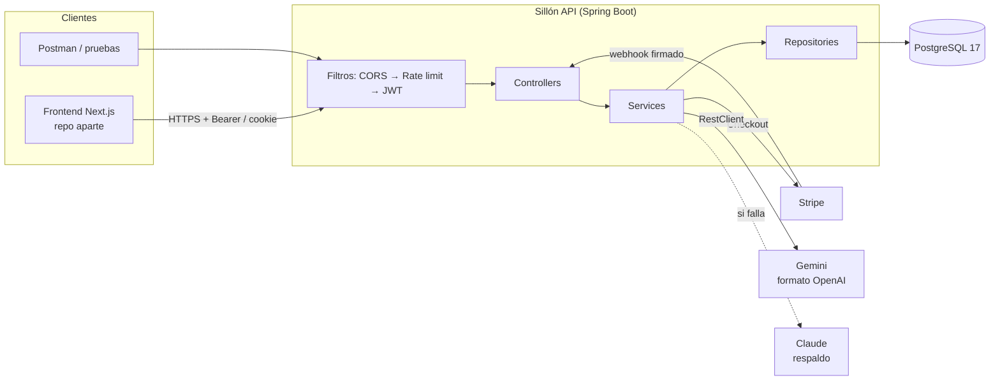
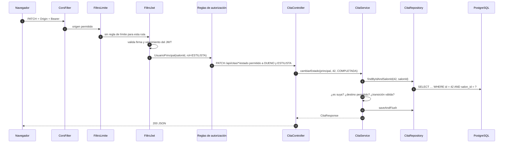

# Arquitectura

## Visión general

Sillón es un **monolito modular**: una sola aplicación Spring Boot, organizada por dominios de negocio con capas internas ([ADR-0001](adr/0001-monolito-modular-por-dominio.md)). Atiende a muchos salones desde una sola base de datos, y cada fila pertenece a un salón ([ADR-0002](adr/0002-multi-inquilino-por-columna.md)).

## Dominios

| Paquete | Responsabilidad |
|---|---|
| `compartido` | Reloj (`Clock` Bogotá), propiedades del negocio, Swagger, formato único de error, rate limit (`limite/`), formato de fechas y moneda para Colombia |
| `seguridad` | Cadena de Spring Security, CORS, filtro JWT, emisión y validación de JWT, usuario autenticado (`UsuarioPrincipal`) |
| `auth` | Registro, login, sesiones de refresco (cookie), logout |
| `salon` | Salón, configuración de horario, plan, créditos de IA, slug, administración |
| `usuario` | Usuarios y estilistas (con los servicios que ofrecen) |
| `servicio` | Catálogo de servicios del salón |
| `cliente` | Clientes del salón (nacen al agendar) |
| `cita` | Agenda: reglas de horario y cruces, transiciones de estado, disponibilidad, recordatorios con IA |
| `publico` | Lo que ve el cliente final sin cuenta: catálogo, disponibilidad, reserva, chat |
| `pago` | Stripe: sesiones de Checkout y webhooks |
| `chat` | Chatbot con IA y bandeja de solicitudes de contacto |
| `ia` | Proveedores de IA, prompts, lectura de JSON y fallback entre proveedores |

Dentro de cada dominio hay una subcarpeta por capa: `config/`, `controller/`, `dto/`, `mapper/`, `model/`, `repository/` y `service/`, solo las que el dominio necesita.

### Dependencias entre dominios

La regla es que **los dominios de negocio dependen de `compartido`, `seguridad` e `ia`, nunca al revés**. Entre dominios de negocio se permite que un servicio use el repositorio o el servicio de otro cuando el negocio lo exige: por ejemplo, `cita` usa `servicio`, `usuario` y `cliente` para agendar. Lo que se evita son los ciclos.

## Recorrido de una petición

Ejemplo: un estilista marca una cita como COMPLETADA (`PATCH /api/citas/42/estado`).

Puntos clave:

- **El salón sale del token** (`UsuarioPrincipal`), nunca de la URL. Pedir la cita 42 de otro salón responde 404, como si no existiera.
- **El controller no decide nada**: recibe, delega y responde.
- **Errores**: cualquier `ExcepcionApi` lanzada en el servicio llega a `ManejadorGlobalErrores`, que la convierte en `{codigo, error, mensaje, fecha}`. Los 401 y 403 de seguridad los escribe `EscritorErroresSeguridad` con el mismo formato, y el 429 lo escribe el `FiltroLimite`.

## Orden de los filtros

| Orden | Filtro | Qué hace | Por qué va ahí |
|---|---|---|---|
| 1 | `CorsFilter` | Responde los preflight `OPTIONS` y rechaza orígenes no permitidos | El preflight llega sin token: si fuera después del JWT, recibiría 401 |
| 2 | `FiltroLimite` | Rate limit por IP, correo o salón | Antes del JWT y de BCrypt: el abuso no consume CPU ni consultas |
| 3 | `FiltroJwt` | Lee `Authorization: Bearer`, valida y carga el usuario | Después del límite |
| 4 | Autorización | Reglas por ruta y rol en `ConfiguracionSeguridad` | — |

## Tiempo y zona horaria

Los servidores corren en UTC, pero el negocio vive en Colombia. Por eso existe un bean `Clock` con zona `America/Bogota`, y todo "hoy" o "ahora" del negocio sale de ahí. Así los tests pueden fijar el tiempo y la app no depende de la zona del servidor.

| Tipo de dato | Clase Java | En PostgreSQL |
|---|---|---|
| Fechas del negocio (citas, creación de salones) | `LocalDateTime`, en hora de Bogotá | `timestamp(6)` |
| Instantes técnicos (vencimiento de sesiones) | `Instant` | `timestamp(6) with time zone` |

## Funcionalidades con IA

Toda funcionalidad con IA sigue el mismo orden (regla R28 de la SPEC), pensado para **no cobrar créditos por errores evitables** y **no mantener transacciones abiertas mientras la IA responde**:

1. Validar lo que no depende de la IA. Por ejemplo, que la cita esté PENDIENTE o CONFIRMADA.
2. Verificar que haya créditos: si no, 402, y la IA no se llama.
3. Llamar a la IA, **fuera de toda transacción**. Puede tardar segundos.
4. Consumir el crédito con un `UPDATE` atómico que nunca deja créditos negativos.
5. Leer y validar el JSON: si es inválido, 502.
6. Aplicar las reglas de negocio, por ejemplo el filtro anti-promesas del chatbot, y responder.

Detalle de proveedores, fallback y costos en [`integraciones.md`](integraciones.md).

## Frontend

El frontend (Next.js) vive en otro repositorio y consume esta API:

- El **access token** vive en memoria del navegador y viaja en `Authorization: Bearer`.
- El **refresh token** vive en una cookie `httpOnly` que el navegador envía sola a `/api/auth/*`.
- Front y API deben compartir *sitio*, por ejemplo `app.dominio.com` y `api.dominio.com`, para que la cookie `SameSite=Strict` funcione.

Detalles en [`seguridad.md`](seguridad.md#sesiones-access-token-y-refresh-token).
