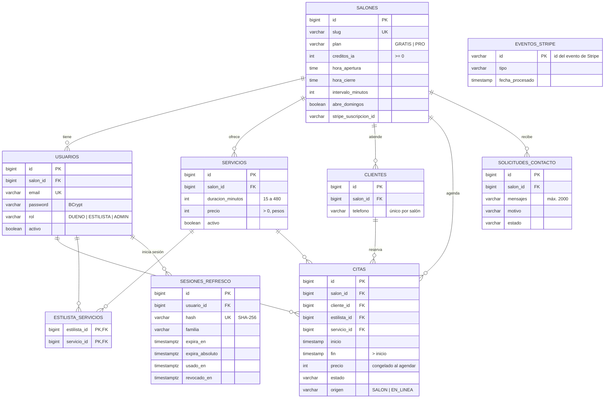

# Base de datos

PostgreSQL 17 en todos los entornos ([ADR-0003](adr/0003-postgresql-en-todos-los-entornos.md)). El esquema lo crea y evoluciona **Flyway**; Hibernate solo lo valida ([ADR-0004](adr/0004-migraciones-con-flyway-y-validate.md)).

## Diagrama entidad-relación



`eventos_stripe` no tiene relaciones a propósito: solo registra qué eventos ya se procesaron, para garantizar la idempotencia.

## Índices y por qué existen

PostgreSQL **no crea índices automáticamente en las llaves foráneas**. Cada índice responde a una consulta concreta:

| Índice | Consulta que acelera |
|---|---|
| `idx_citas_estilista_inicio` | Detectar cruces al agendar y calcular la disponibilidad de un estilista |
| `idx_citas_salon_inicio` | La agenda del día del salón (`GET /api/citas?fecha=`) |
| `idx_citas_cliente`, `idx_citas_servicio` | Búsquedas por cliente o servicio, y verificación de las FK |
| `idx_servicios_salon` | Catálogo del salón |
| `idx_usuarios_salon_rol` | Listar los estilistas de un salón y contar los del plan GRATIS |
| `idx_estilista_servicios_servicio` | Estilistas que ofrecen un servicio |
| `idx_solicitudes_salon_fecha` | Bandeja de solicitudes, de la más reciente a la más antigua |
| `idx_sesion_familia` | Revocar una sesión completa |
| `idx_sesion_expira_absoluto` | Limpieza diaria de sesiones vencidas |
| `idx_sesion_usuario` | Sesiones de un usuario |

Los `unique` (`slug`, `email`, `hash`, `salon_id + telefono`) ya crean su propio índice.

## Integridad en la base de datos

Las reglas viven en Java, pero la base de datos tiene una **segunda barrera** contra bugs y cambios hechos a mano:

- `check` en todos los enums: estado, origen, plan, rol, motivo.
- `ck_citas_fin_despues_de_inicio`, `ck_servicios_duracion` (15 a 480), `ck_servicios_precio_positivo`, `ck_salones_creditos_no_negativos`, `ck_salones_horario` (apertura antes del cierre).
- Todas las constraints tienen nombre legible (`fk_citas_cliente`, `uk_salones_slug`…), así un error de PostgreSQL dice qué regla se violó.

## Flyway: reglas de trabajo

| Regla | Por qué |
|---|---|
| Archivos en `src/main/resources/db/migration/V<n>__descripcion.sql`, con **dos** guiones bajos | Con uno solo, Flyway ignora el archivo sin avisar |
| Nunca se edita una migración aplicada | Flyway guarda el checksum de cada una; si cambia, la app no arranca |
| Cada cambio de entidad va con su migración en el **mismo PR** | `validate` no detecta todo (ver abajo) |
| Agregar un valor a un enum persistido requiere una migración que actualice su `check` | Si no, PostgreSQL rechaza el valor nuevo |
| En tablas grandes, crear índices con `create index concurrently` en una migración aparte | Evita bloquear la tabla en producción |

### Qué valida `ddl-auto=validate` y qué no

| Valida ✅ | No valida ❌ |
|---|---|
| Que existan las tablas de cada entidad | Longitud de los `varchar` |
| Que existan las columnas mapeadas | `nullable`, `unique`, índices, `check` |
| Que los tipos sean compatibles | Llaves foráneas |

## Operaciones comunes

```bash
# Encender o apagar la base local
docker compose up -d
docker compose down

# Empezar de cero (BORRA los datos locales)
docker compose down -v && docker compose up -d

# Consola SQL
docker exec -it sillon-postgres psql -U sillon -d sillon

# Estado de las migraciones
docker exec sillon-postgres psql -U sillon -d sillon -c "select version, description, success, installed_on from flyway_schema_history order by installed_rank;"
```

## Producción

- **Base nueva y vacía:** Flyway la crea desde `V1`. No se reutiliza la base del despliegue del curso.
- **Conexión:** directa o *session pooler* (puerto 5432), **no** *transaction pooler* (6543). Flyway necesita una sesión estable para su bloqueo de migración.
- **Pool de conexiones:** `spring.datasource.hikari.maximum-pool-size=5`, pensado para los planes gratuitos de PostgreSQL gestionado. Súbelo según el plan.
- Respaldos y restauración: ver [`operacion.md`](operacion.md).
