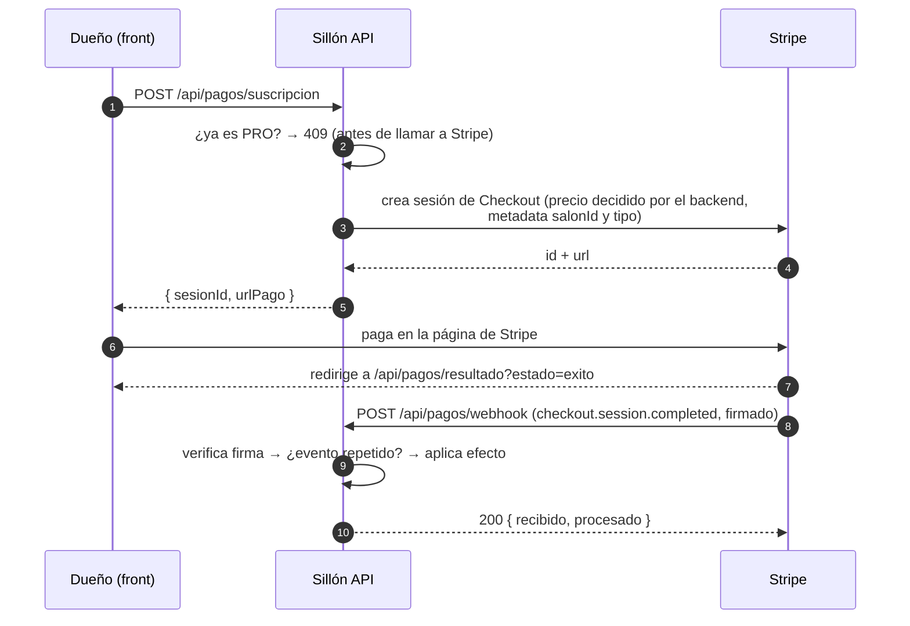

# Integraciones externas

## Stripe

Sillón cobra a los **salones** (no a sus clientes): una suscripción PRO mensual y paquetes de créditos de IA de pago único. Cobrarle al cliente final requeriría Stripe Connect y está fuera de alcance.

### Flujo de compra



**El dueño no tiene el plan PRO cuando vuelve de Stripe: lo tiene cuando llega el webhook.** Normalmente llega en segundos. El front debe consultar `/api/salon` en vez de asumir el resultado por la URL de retorno.

### Webhook

| Evento | Efecto |
|---|---|
| `checkout.session.completed` con `payment_status = paid` y tipo `SUSCRIPCION_PRO` | Plan PRO, guarda el id de la suscripción, +300 créditos |
| Mismo evento, tipo `PAQUETE_CREDITOS` | +200 créditos |
| `customer.subscription.deleted` | Vuelve a GRATIS **conservando** los créditos |

Garantías:

1. **Firma:** `Webhook.Signature.verifyHeader` sobre el cuerpo **crudo** (un `String`), con una tolerancia de 300 s. Cualquier conversión previa del cuerpo rompería la firma.
2. **Lectura con Jackson y no con los modelos de Stripe:** el `api_version` de los eventos puede no coincidir con el de la librería y el objeto llegaría vacío ([ADR-0009](adr/0009-webhooks-stripe-firma-y-jackson.md)).
3. **Idempotencia:** el id del evento se guarda en `eventos_stripe` **en la misma transacción** que el efecto. Stripe reintenta los webhooks; un evento repetido responde `procesado: false` sin cambiar nada.

### Probar pagos en local

```bash
stripe listen --events checkout.session.completed,customer.subscription.deleted \
  --forward-to localhost:8080/api/pagos/webhook
```

Copia el `whsec_` que imprime en `sillon.stripe.secreto-webhook` de tu `secrets.properties`. Es **distinto** del secreto del destino de webhook de producción. Tarjeta de prueba: `4242 4242 4242 4242`, con cualquier fecha futura y cualquier CVC.

### Configuración en producción

1. Crea en Stripe los dos precios (suscripción mensual y pago único) y pon sus ids en `STRIPE_PRECIO_PRO` y `STRIPE_PRECIO_CREDITOS`.
2. Crea un destino de webhook apuntando a `https://<tu-api>/api/pagos/webhook` con los dos eventos de la tabla, y pon su `whsec_` en `STRIPE_SECRETO_WEBHOOK`.

---

## Inteligencia artificial

Dos funciones: **recordatorios** (el dueño los pide para una cita) y **chatbot** (público, en la página del salón). Cada respuesta cuesta **1 crédito** del salón.

### Proveedores y fallback

```mermaid
flowchart LR
    A[AsistenteIA] -->|"@Order(1)"| G[ProveedorOpenAi<br/>Gemini con formato OpenAI]
    G -->|ok| R[RespuestaIA + factura]
    G -->|falla| C[ProveedorClaude<br/>@Order 2]
    C -->|ok| R
    C -->|falla| E[503 IaNoDisponible]
```

- **Sin SDKs:** HTTP directo con `RestClient` ([ADR-0010](adr/0010-ia-por-http-con-fallback-y-creditos-atomicos.md)). Agregar un proveedor es implementar `ProveedorIA` y darle un `@Order`.
- **Tipos de fallo en el log:** `ERROR` es de configuración (respuestas 400, 401, 403 o 404: llave, URL o modelo mal configurados) y hay que arreglarlo; `WARN` es temporal (429, 5xx o tiempo agotado). En ambos casos se intenta el siguiente proveedor.
- **Sin llave configurada:** el proveedor falla sin hacer la llamada HTTP.
- **Factura:** cada respuesta incluye proveedor, modelo, tokens y costo estimado en USD, calculado con los precios por millón de tokens de la configuración.

### Créditos

1. Se **verifica** que el salón tenga créditos **antes** de llamar a la IA (402 si no tiene).
2. Se **consumen** solo si la IA respondió, con `UPDATE salones SET creditos_ia = creditos_ia - 1 WHERE id = ? AND creditos_ia > 0`: atómico y nunca negativo.
3. Si la IA responde un JSON inválido, el crédito **ya se consumió** (502): la IA sí trabajó y costó tokens.

### Prompts

Viven en `src/main/resources/prompts/` y se cargan con `BibliotecaPrompts`. Nunca van dentro del código Java.

| Prompt | Variables | Responde |
|---|---|---|
| `recordatorio.txt` | `salon`, `cliente`, `datos` | `{"mensaje": "…"}` (máximo 700 caracteres) |
| `chatbot.txt` | `salon`, `direccion`, `horario`, `catalogo`, `cliente` | `{"respuesta": "…", "escalar": true \| false}` |

**Reglas de diseño:**

- Los **datos verificados** los calcula Java (servicio, estilista, fecha y hora formateadas para Colombia, valor, dirección) y van como líneas con etiqueta. La IA solo redacta.
- El **texto del cliente** va siempre como mensaje de usuario, nunca dentro de las instrucciones.
- **Filtro anti-promesas en Java:** si la respuesta del chatbot menciona descuentos, cupones, gratis, promociones o reembolsos, se reemplaza por un mensaje seguro fijo y se crea una solicitud con motivo `REGLA_DE_SEGURIDAD`. Se aceptan los falsos positivos a cambio de que la IA nunca prometa algo que el salón no ofrece.
- **Escalar:** si la IA indica `escalar: true` (por ejemplo, el cliente quiere agendar o cancelar), se crea una solicitud de contacto con los mensajes del cliente para que una persona responda.

### Costos

Con los precios de la configuración (0.30 USD de entrada y 2.50 USD de salida por millón de tokens), un recordatorio o un mensaje de chat típico cuesta una fracción de centavo de dólar. La protección contra abuso no está en el precio por llamada, sino en los créditos por salón y en el rate limit por salón del chat (100 por hora).
