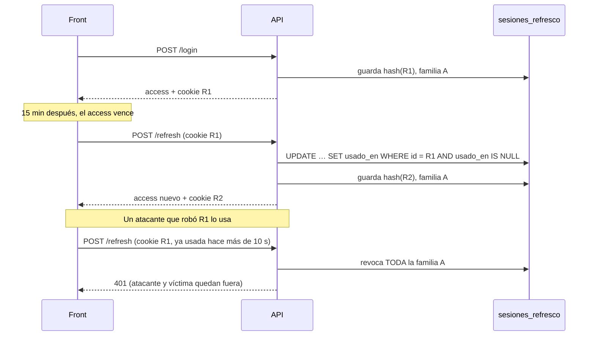

# Seguridad

## Modelo de amenazas (resumen)

| Activo | Amenaza | Defensa |
|---|---|---|
| Datos de cada salón | Un salón lee o modifica datos de otro | Aislamiento multi-inquilino: el `salonId` sale del token y toda consulta filtra por él (404 si no coincide) |
| Cuentas | Fuerza bruta o relleno de credenciales | BCrypt, 401 genérico, rate limit por IP y por correo |
| Sesiones | Robo de token por XSS | Access token corto (15 min) solo en memoria; refresh token en cookie `httpOnly` |
| Sesiones | Robo del refresh token | Rotación en cada uso y detección de reuso que revoca la sesión completa |
| Sesiones | CSRF sobre `/refresh` | Cookie `SameSite=Strict` + lista blanca de CORS |
| Créditos de IA | Agotarlos desde el chat público | Rate limit por IP y **por salón**, para que rotar IPs no sirva |
| Agenda | Llenarla con reservas falsas | Rate limit por IP y por salón en reservas |
| Pagos | Webhooks falsificados o repetidos | Firma de Stripe verificada e idempotencia por id de evento |
| Firma de tokens | Secreto conocido o débil | Secreto obligatorio de 32 caracteres o más, sin valor por defecto, validado al arrancar |
| Servidor | Ejecución remota tras una vulnerabilidad | Contenedor sin root, `.jar` de solo lectura |
| Dependencias | Vulnerabilidades conocidas | Dependabot semanal + CI |

## Autenticación y autorización

- **Contraseñas:** BCrypt. El login responde 401 con un mensaje genérico, sin decir si falló el correo o la contraseña (R6).
- **Roles:** `DUENO`, `ESTILISTA` y `ADMIN`. Las reglas por ruta viven en `ConfiguracionSeguridad`; la matriz completa está en la [SPEC](../SPEC.md#matriz-de-permisos). `ADMIN` no se puede crear por la API: se asigna directo en la base de datos.
- **Multi-inquilino:** ver [ADR-0002](adr/0002-multi-inquilino-por-columna.md). Responder 404 y no 403 ante datos de otro salón evita confirmar que un id existe.

## Sesiones: access token y refresh token

Decisión y alternativas en [ADR-0005](adr/0005-jwt-corto-y-refresh-token-en-cookie.md).

| | Access token | Refresh token |
|---|---|---|
| Formato | JWT firmado con HMAC-SHA (jjwt elige HS256, HS384 o HS512 según el largo del secreto) | 32 bytes aleatorios (`SecureRandom`), Base64 URL |
| Vida | 15 minutos | 7 días sin uso · máximo 30 días desde el login |
| Viaja en | Cuerpo de la respuesta → `Authorization: Bearer` | Cookie `sillon_refresh` |
| En el navegador | Solo en memoria | Lo guarda el navegador; JavaScript no puede leerlo |
| En la base de datos | No se guarda | Solo el hash SHA-256 (tabla `sesiones_refresco`) |

**Atributos de la cookie:** `HttpOnly; Secure; SameSite=Strict; Path=/api/auth; Max-Age=604800`. `Secure` se desactiva solo en local (`sillon.sesion.cookie-segura=false`), porque `localhost` es HTTP.

### Rotación y detección de reuso

- **Ventana de gracia de 10 s:** si el token se usó hace menos de 10 segundos, se responde 401 **sin revocar**. Cubre el caso de dos pestañas que refrescan a la vez: comparten la cookie, así que la pestaña que pierde reintenta con la nueva.
- **Carreras:** marcar el token como usado es un `UPDATE` condicional. Si llegan dos peticiones al mismo tiempo, solo una gana.
- **`noRollbackFor`:** `SesionService.rotar` revoca y luego lanza 401. Sin `noRollbackFor = SesionInvalidaException.class`, la excepción desharía la revocación y el atacante conservaría la sesión.
- **Logout:** revoca la familia del dispositivo actual. El access token emitido sigue sirviendo hasta 15 minutos; es el costo aceptado de los JWT sin estado.
- **Limpieza:** todos los días a las 3:30 a. m. (Bogotá) se borran las sesiones cuyo máximo absoluto venció hace más de 7 días.

## Rate limit

Decisión en [ADR-0006](adr/0006-rate-limit-en-memoria-con-bucket4j.md). Límites en la [SPEC, R38](../SPEC.md#88-sesiones-y-protección-de-la-api); todos los números viven en el enum `ReglaLimite`.

- **Algoritmo:** token bucket (Bucket4j). Cada regla y clave tiene un balde con N fichas que se rellenan de forma continua.
- **Dónde corre:** `FiltroLimite`, antes del JWT. El límite por correo del login está en `AuthService`, porque necesita el cuerpo, y se aplica **antes** de BCrypt.
- **Respuesta:** 429 con `Retry-After`, en el formato único de error.
- **Memoria:** caché Caffeine con un tope de 100.000 baldes y expiración tras 1 hora sin uso.
- **Limitaciones aceptadas:** cada instancia cuenta por separado y un reinicio borra los contadores. El límite por correo permite que un tercero bloquee el login de una cuenta durante unos minutos.

### La IP del cliente

Decisión en [ADR-0007](adr/0007-ip-real-con-forward-headers-native.md). En producción, `server.forward-headers-strategy=native` deja que Tomcat recorra `X-Forwarded-For` **de derecha a izquierda**, saltando solo proxies de red privada. Así, lo que el cliente escriba en ese header no cambia su IP.

> ⚠️ Esto solo es seguro si **nadie puede llegar a la app sin pasar por el proxy**. En cualquier plataforma, el contenedor no debe exponerse directamente a internet.

## CORS

- Lista blanca exacta en `CORS_ORIGENES`, validada al arrancar: sin `*`, sin barra final y sin placeholders, y `https://` obligatorio salvo para `http://localhost`.
- Métodos: `GET`, `POST`, `PUT`, `PATCH`. Headers: `Authorization` y `Content-Type`. Con `allowCredentials=true` para la cookie de sesión.
- CORS **no es autenticación**: solo controla lo que el navegador deja leer a JavaScript. `curl` lo ignora.

## Configuración segura por defecto

Ver [ADR-0008](adr/0008-configuracion-segura-por-defecto.md) y [`configuracion.md`](configuracion.md).

- `JWT_SECRETO` no tiene valor por defecto en ningún entorno. Si falta, está vacío, mide menos de 32 caracteres o llega como `${...}` literal, la app no arranca.
- El perfil `prod` exige base de datos, URL pública y CORS sin valores por defecto, apaga Swagger y no expone detalles de error.
- Los secretos nunca van en el repositorio. `.claude/settings.json` impide que Claude Code lea `secrets.properties`, `.env` y llaves.

## Pagos

- El webhook verifica la firma `Stripe-Signature` sobre el cuerpo **crudo**, con una tolerancia de 300 segundos. Sin firma o con firma inválida: 400.
- Idempotencia: el id de cada evento se guarda en `eventos_stripe`, en la misma transacción que el efecto. Si llega repetido, no cambia nada.
- El precio lo decide el backend: el cliente nunca envía montos ni ids de precio (R22).

## IA

- El texto del cliente nunca se mezcla con las instrucciones: va como mensaje de usuario. Esto reduce, aunque no elimina, la inyección de prompts.
- **Filtro anti-promesas en Java (R31):** si la respuesta menciona descuentos, cupones, "gratis", promociones o reembolsos, el cliente recibe un mensaje seguro fijo y se escala a una persona. No depende de que el modelo obedezca.
- Nunca se registran en logs el mensaje del cliente, sus datos ni las llaves.

## Contenedor

Ver [ADR-0012](adr/0012-contenedor-sin-root.md). Usuario `10001` sin privilegios, `.jar` de root en solo lectura y `-XX:+ExitOnOutOfMemoryError` para que la plataforma reinicie la app en vez de dejarla viva pero inservible.

---

## Revisión de seguridad (noviembre 2026)

Revisión completa del backend después de la entrega del curso. Todos los hallazgos quedaron resueltos en la tanda B0–B6.

| # | Hallazgo | Riesgo | Resolución |
|---|---|---|---|
| 1 | `JWT_SECRETO` con valor por defecto público en el repo: cualquiera podía firmar un token de ADMIN si faltaba la variable | 🔴 Crítico | **B1:** secreto obligatorio, validado al arrancar, y test que rechaza placeholders |
| 2 | Chat público sin límite: permitía agotar los créditos de IA de un salón | 🔴 Alto | **B4:** 10 por minuto por IP y 100 por hora por salón |
| 3 | Login y registro sin límite de intentos | 🟠 Alto | **B4:** 5 por minuto por IP, 10 cada 15 minutos por correo, 3 registros por hora por IP |
| 4 | Reservas públicas sin límite | 🟠 Medio | **B4:** 5 cada 10 minutos por IP y 30 por hora por salón |
| 5 | Token de 8 h, sin refresh ni revocación | 🟠 Medio | **B3:** access de 15 min, refresh con rotación y logout |
| 6 | Sin CORS | 🟡 Bloqueante para el front | **B2:** lista blanca validada al arrancar |
| 7 | `ddl-auto=update` en producción | 🟡 Medio | **B5:** Flyway y `validate` |
| 8 | Swagger abierto en producción | 🟡 Bajo | **B1:** apagado en el perfil `prod` |
| 9 | Contenedor como root | 🟡 Bajo | **B6:** usuario `10001` |
| 10 | Sin CI ni revisión de dependencias | 🟡 Bajo | **B0:** GitHub Actions y Dependabot |
| — | *Encontrado durante B4:* `forward-headers-strategy=framework` dejaba falsificar la IP con `X-Forwarded-For` | 🟠 Alto | **B4:** cambio a `native` |

### Pendientes conocidos (no son vulnerabilidades hoy)

- **Rate limit distribuido:** con más de una instancia, migrar Bucket4j a Redis.
- **"Cerrar sesión en todos los dispositivos"** y revocación al cambiar la contraseña: no existe todavía un endpoint de cambio de contraseña.
- **Revocación inmediata del access token:** requeriría una lista de revocación; hoy se acepta la ventana de 15 minutos.
- **Verificación de correo** al registrarse.
